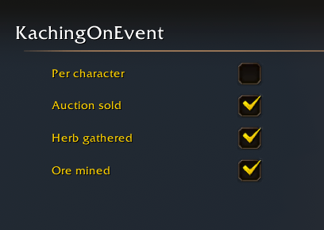

# KachingOnEvent

Plays a "kaching" sound when one of your auctions sells, when you gather an herb, or when
you mine a deposit.

## Features

- **Auction sold** - kaching when the auction house reports that one of your auctions sold.
- **Herb gathered** - kaching when an herb gathering cast succeeds.
- **Ore mined** - kaching when a mining cast succeeds.
- **Remembered** - settings are saved per account, or per character with one checkbox;
  all three triggers are on by default.
- **Settings page** - all options in the game menu under Options > AddOns, also opened
  from the addon compartment menu.
- **Chat commands** - every option can also be changed by slash command.

## Screenshots



## Install

1. Download `KachingOnEvent-vX.Y.Z.zip` from the [releases](https://github.com/tf4482/KachingOnEvent/releases) or
   [CurseForge](https://www.curseforge.com/projects/1823978).
2. Unzip it into `World of Warcraft/_forever_/Interface/AddOns/`.
3. Restart the game or type `/reload`.

## Usage

```text
/kaching                    show the current state
/kaching auction on|off     kaching when an auction sells
/kaching herb on|off        kaching when you gather an herb
/kaching mining on|off      kaching when you mine a deposit
/kaching character on|off   use settings for this character only, or the account's
/kaching test               play the kaching sound once now
/kaching reset              reset the settings to defaults
/kaching debug on|off       show what the addon does, until /reload
/kaching config             open the settings page
/kaching help               list all commands
```

## Examples

- Only care about gold: `/kaching herb off` and `/kaching mining off`.
- Your farming alt should ring on every node, your main only on sales: on the main type
  `/kaching character on`, then `/kaching herb off` and `/kaching mining off`.
- Check what is active: `/kaching`.
- No sound on a sale: `/kaching test` checks the sound, `/kaching debug on` shows which
  events arrive.

## Develop

Check the code with [Luacheck](https://github.com/lunarmodules/luacheck) before each commit
(CI runs it on every push):

```text
luacheck .
```

Deploy locally: run `deploy.bat`; it builds `release/KachingOnEvent-vX.Y.Z.zip` from `VERSION`.

Release: set `VERSION` to `X.Y.Z`, then push an annotated tag `vX.Y.Z`; GitHub Actions
packages the addon with the BigWigs packager and publishes it.

## License

All rights reserved, see [LICENSE](LICENSE).
